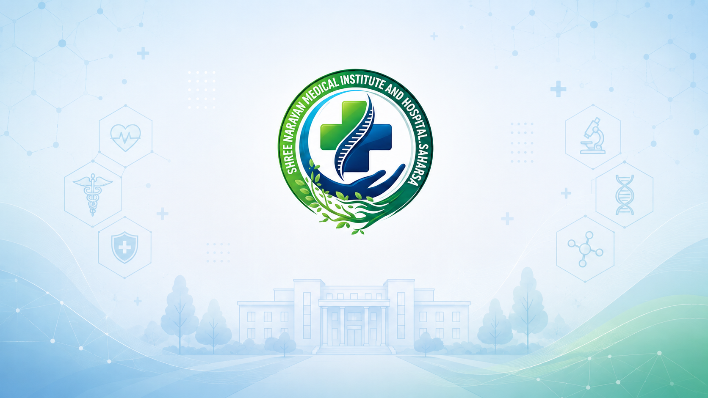

# SNMIH Website

The official institutional website for SNMIH, built with Next.js and Payload CMS. The public website and editorial admin run in one TypeScript application, giving visitors fast, accessible pages while allowing authorized editors to manage content without code changes.

The project began with the Payload CMS marketing starter and is configured as a single-site, single-dataset deployment for SNMIH. It includes governed pages, articles, news and events, reviews, forms, media, navigation, system pages, SEO, analytics consent, operational queues, and feature-based admin access.

## Supported Platform Contract

- local development: `MongoDB` plus local-disk uploads
- email: `none` or `resend`
- hosted database target: `MongoDB`
- Vercel media target: `S3-compatible` object storage such as `IDrive e2`

The repo fails fast if you try to boot a Vercel production profile with the default local-disk `media` behavior. Use `MEDIA_PROVIDER=s3` with a durable bucket before allowing editor-managed uploads in hosted environments.

## Getting Started

1. Copy `.env.example` to `.env`.
2. Start MongoDB locally with `docker compose up -d mongo`, or point `MONGODB_URI` at an existing MongoDB instance and set `DATABASE_NAME` to the database this site should use.
3. Set `PAYLOAD_SECRET`.
4. Run `pnpm install`.
5. Run `pnpm dev`.
6. Open the website at [http://localhost:3000](http://localhost:3000) and Payload Admin at [http://localhost:3000/admin](http://localhost:3000/admin). On a new database, Payload will guide you through creating the first Admin account.

## Production Docker Image

The supplied `Dockerfile` builds the Next.js standalone production server. Build it with `docker build -t snmih-website .` and run it with the environment variables described below.

Production containers require a durable external MongoDB database and `MEDIA_PROVIDER=s3` with a durable S3-compatible bucket. The image intentionally does not provide persistent local-disk uploads. `docker-compose.yml` remains the local-development workflow and is not a production stack.

## Platform Capabilities

**Content and structure**

- hierarchical pages with live preview, native drafts and publishing guardrails, managed homepage selection, and automatic old-path preservation when a published slug or parent changes
- reusable section templates — shared block groups that sync across all pages that reference them
- navigation links, headers, footers, and CMS-managed system pages (404, maintenance, coming soon)
- articles with lexical rich text, taxonomies (categories + tags), SEO fields, and live preview
- moderated reviews promoted from form submissions into public editorial content
- classification-backed news and events with live preview, manually prioritized eligible Events in Highlights, complete News & Events Tabs directories, and gallery albums
- 64 selectable Page blocks covering editorial, events, Calendar and Annual Calendar, media, forms, reviews, galleries, offices, and reusable sections
- production Page block error boundaries that prevent one broken layout block from crashing the remaining Page

**SEO and discoverability**

- sitemap with full pagination — no artificial 100-document cap, includes lastmod dates
- dynamic `robots.txt` controlled by CMS global setting
- server-generated Open Graph images for the site default, articles, reviews, and news/events; generic CMS pages inherit configured metadata and default media
- structured data: Organization, WebSite + SearchAction, Article, Event, BreadcrumbList, WebPage JSON-LD schemas
- title templates, default Open Graph image, per-route robots override, and Google site verification

**Analytics and privacy**

- Analytics & Tracking global for Google Tag Manager and GA4 with format validation
- configurable cookie banner with consent-gated analytics — no analytics load before visitor acceptance; legal compliance still requires jurisdiction-specific review
- analytics integrations mount only after consent and can activate immediately without a navigation

**Search**

- site-wide full-text search at `/search` (SSR) and a `Cmd+K` / `Ctrl+K` overlay dialog
- debounced instant results, keyboard navigation, and accessible combobox ARIA pattern
- rate-limited API endpoint (`/api/search`) — 20 requests per IP per 10 seconds
- WebSite JSON-LD describes the onsite search action (Google retired the Sitelinks Search Box visual result in 2024)

**Redirects**

- CMS-managed redirect collection with page relationship or custom URL destinations
- published Page slug and parent-path changes automatically create permanent redirects for the former path, including affected descendants
- Payload Admin and REST retain `/api/redirects`; the public request proxy reads its published redirect map from the separate `/api/public-redirects` endpoint
- request proxy — redirects go live within 60 seconds of publishing, no rebuild needed
- in-process TTL cache in the request proxy; `unstable_cache` + tag invalidation on the API side

**Feeds and syndication**

- RSS 2.0 feeds with Atom self-links at `/articles/feed.xml` and `/news-events/feed.xml`
- `<link rel="alternate">` autodiscovery in layout `<head>`

**Performance and caching**

- persistent tagged caching for layout globals, Pages, and redirects; request-level deduplication for article/review data; time-based revalidation for sitemap, robots, and feeds
- full sitemap pagination via `fetchAllDocs()` helper — no silent content truncation

**Forms and lead capture**

- forms with text, email, phone, textarea, select, and checkbox fields, submission intent routing, spam protection, and assignment
- responsive branded team notification emails with site-timezone dates and optional submitter confirmation email (CMS-configured subject + message)
- form submissions with follow-up state, assignment, and optional review promotion

**Security and accessibility**

- security headers: `X-Frame-Options`, `X-Content-Type-Options`, `Referrer-Policy`, `Permissions-Policy`, `HSTS`
- skip navigation link, `<main id="main-content">` landmark, `role="search"` on search forms
- optional Section Anchor IDs on every Page-compatible block, with sticky-header clearance, smooth fragment navigation, and reduced-motion support
- `aria-live` regions on dynamic content, accessible cookie consent dialog, focus rings on interactive elements

**Editorial tooling**

- editorial governance, publish guardrails, and operational audit history
- custom admin dashboard with content counts, recent submissions, and quick-action links
- live preview for articles and news-events via `useLivePreview` + `RefreshRouteOnSave`
- two-role access model: Admin and Site Manager, with 33 individually grantable Admin features

## Role Model

- `Admin`: full access to every feature, user and grant management, and recovery controls
- `Site Manager`: access only to the features explicitly granted by an Admin; multiple Site Managers may have different grant sets

The first account is always an Admin. Admins may create additional Admins or Site Managers. The last active Admin cannot be demoted or deleted. See [Editorial governance](docs/operations/editorial-governance.md) for the complete feature catalog and dependency rules.

## Content Ownership

The CMS separates content, taxonomy, structure, media, intake, administration, and site-wide defaults:

- `pages`, `reusable-sections`, `articles`, `news-events`, and `reviews` own public content
- `celebrations` owns scheduled site-wide or page-level celebration modals
- `categories` (shown as Topics) and `tags` own taxonomy
- `navigation-links`, `redirects`, `headers`, `footers`, `office-locations`, and `system-pages` own navigation and structure
- `media` and `gallery-albums` own governed assets and albums
- `forms` and `form-submissions` own intake and lead operations
- `work-queue`, `operational-audit-events`, and `users` own administration
- 9 globals own identity, appearance, SEO, analytics, consent, layout defaults, the News & Events detail template, search suggestions, and maintenance modes
- Optional per-account authenticator-app 2FA with single-use recovery codes; setup lives under `/admin/account`. See [account security](docs/guides/users.md#two-factor-authentication).

## Admin Information Architecture

The operator-facing admin is organized into ten groups:

- `Content`
- `News & Events`
- `Taxonomy`
- `Navigation`
- `Site Structure`
- `Media`
- `Forms`
- `Settings`
- `Configuration`
- `Administration`

See [docs/architecture/content-model-map.md](docs/architecture/content-model-map.md) for the full ownership map.

## Documentation

- [CMS operator guide](docs/guides/README.md)
- [Starter clone checklist](docs/operations/starter-clone-checklist.md)
- [Content model map](docs/architecture/content-model-map.md)
- [Complete feature inventory](docs/architecture/feature-inventory.md)
- [Editorial governance](docs/operations/editorial-governance.md)
- [MongoDB deployment](docs/operations/mongodb-deployment.md)
- [Production database backups](docs/operations/database-backups.md)
- [Runtime and providers](docs/operations/runtime-and-providers.md)
- [Developer workflows](docs/operations/developer-workflows.md)

### Feature guides

- [Analytics & Tracking](docs/guides/analytics.md) — GTM, GA4, and consent gating
- [Site Search](docs/guides/search.md) — Cmd+K dialog and /search page
- [Reusable Sections](docs/guides/reusable-sections.md) — shared block templates
- [Celebrations](docs/guides/celebrations.md) — scheduled celebration modals with confetti
- [Redirects](docs/guides/redirects.md) — CMS-managed URL redirects
- [Forms](docs/guides/forms.md) — form definitions and submitter confirmation email
- [News & Events](docs/guides/news-events.md) — entry authoring, Page-backed listings, live preview, and feed
- [Disclosure Proforma](docs/guides/disclosure-proforma.md) — reporting periods, configurable tables and publication credits
- [Page Blocks](docs/guides/blocks.md) — all 64 Page layout choices and their data dependencies
- [Cookie Consent Banner](docs/guides/cookie-consent.md) — consent variants, copy, and analytics behavior

## Environment

Local development defaults:

- `MONGODB_URI=mongodb://127.0.0.1:27017`
- `DATABASE_NAME=payload-cms-starter-kit`
- `PAYLOAD_SECRET`
- `EMAIL_PROVIDER=none`
- `MEDIA_PROVIDER=localDisk`

Optional email variables:

- `RESEND_API_KEY`
- `RESEND_FROM_EMAIL`
- `RESEND_FROM_NAME`
- `RESEND_OVERRIDE_TO_EMAIL`

Preview and production URL support:

- `NEXT_PUBLIC_SERVER_URL`

SNMIH Atlas database selection:

- Staging: `DATABASE_NAME=stage`
- Production: `DATABASE_NAME=prod`

S3-compatible media storage for hosted uploads:

- `MEDIA_PROVIDER=s3`
- `S3_BUCKET`
- `S3_ENDPOINT`
- `S3_REGION`
- `S3_ACCESS_KEY_ID`
- `S3_SECRET_ACCESS_KEY`
- `S3_PUBLIC_URL` for direct public/CDN delivery
- `S3_ACL=none | public-read | private`
- `S3_FORCE_PATH_STYLE=true | false`
- `S3_CLIENT_UPLOADS=true | false`
- `MEDIA_RECONCILE_TOKEN` for the protected media health endpoint

Optional tooling:

- `SHADCNBLOCKS_API_KEY`

## Tooling

- `Node.js`: `^18.20.2 || >=20.9.0`
- `pnpm`: `^9 || ^10 || ^11`

## Testing

- `pnpm test:int`
- `pnpm test:e2e`
- `pnpm test`

Use an isolated MongoDB database for tests. E2E helpers seed and delete known test users and homepage content. See [Developer Workflows](docs/operations/developer-workflows.md) for browser installation, generation, backup, migration, and reconciliation commands.

## Project Conventions

- Treat this repo as one deployment and one dataset per client site.
- Replace branding and operational defaults through globals before changing collection structure.
- Extend behavior through `src/lib` or `src/config` seams instead of editing core collection logic ad hoc.
- Treat provider configuration as runtime configuration, not content-model logic.
- Keep the starter contract explicit. If a deployment path is not safe, document it and reject it early.
- Add new blocks only after the CMS foundation, guardrails, and operational seams are stable.
